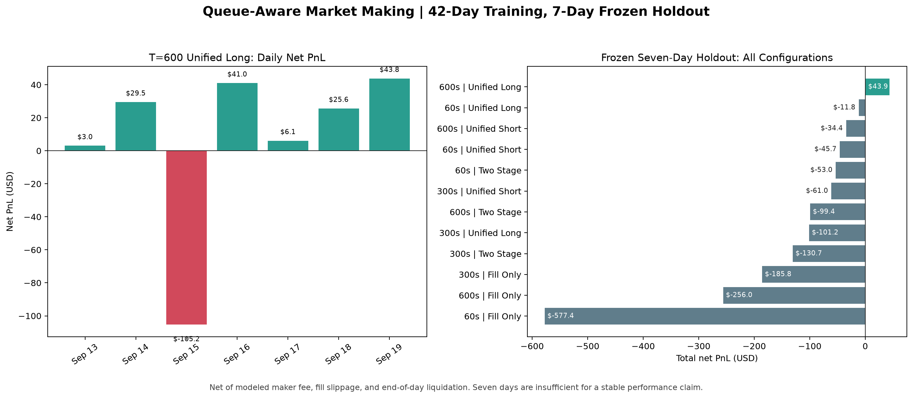

# Queue-Aware Market Making

A reproducible BTC/USDT study of limit-order fills, adverse selection, and direct
net-outcome prediction. Models are trained on 42 chronological days and frozen
before a seven-day holdout from September 13 through September 19, 2026.

The main result is narrow but valid: the 600 second unified-long model earned
**+$43.87** after modeled fees, slippage, inventory limits, and end-of-day
liquidation. It was profitable on six of seven days. The other 11 strategy
configurations were negative.



## Research question

A passive order may be easy to fill and still be economically harmful. The study
compares four quote-ranking objectives:

1. `fill_only`: predicted fill probability times available depth after explicit cost;
2. `two_stage`: fill probability adjusted by predicted adverse selection;
3. `unified_short`: direct net-outcome prediction using 17 short-context features;
4. `unified_long`: direct net-outcome prediction using 28 short- and long-context features.

Each objective is tested at 60, 300, and 600 second horizons. At every one-second
decision time, the strategy compares 12 quote depths on both sides of the book.

## Experimental design

| Component | Setting |
|---|---|
| Market | Binance Spot BTCUSDT |
| Raw data | 100 ms L2 updates and tick trades |
| Training | 2026-08-02 through 2026-09-12, 42 days |
| Frozen holdout | 2026-09-13 through 2026-09-19, 7 complete days |
| Horizons | 60, 300, and 600 seconds |
| Quote depths | 0.1 to 30 bps, 12 values |
| Training rows | 85.9M to 86.9M per horizon |
| Order size | 0.01 BTC |
| Inventory cap | +/-0.10 BTC |
| Per-fill cost | 1.0 bps fee + 0.5 bps slippage |
| End-of-day liquidation | 2.0 bps slippage |

The fill label uses integer quantities and requires qualifying trade volume to
exceed queue ahead strictly after placement and before expiry. No holdout row is
used for model fitting.

## Result

| Horizon | Objective | Total PnL | Winning days |
|---:|---|---:|---:|
| 60 s | Fill only | -$577.44 | 0 / 7 |
| 60 s | Two stage | -$52.99 | 2 / 7 |
| 60 s | Unified short | -$45.68 | 1 / 7 |
| 60 s | Unified long | -$11.77 | 3 / 7 |
| 300 s | Fill only | -$185.79 | 3 / 7 |
| 300 s | Two stage | -$130.66 | 3 / 7 |
| 300 s | Unified short | -$60.97 | 5 / 7 |
| 300 s | Unified long | -$101.22 | 4 / 7 |
| 600 s | Fill only | -$256.00 | 3 / 7 |
| 600 s | Two stage | -$99.45 | 4 / 7 |
| 600 s | Unified short | -$34.42 | 4 / 7 |
| **600 s** | **Unified long** | **+$43.87** | **6 / 7** |

The positive configuration completed 212 fills, averaged +$6.27 per day and
+$0.207 per fill, and had a -$105.24 maximum drawdown. The reported annualized
Sharpe of 2.32 is not stable because it is estimated from only seven daily
observations.

## Important follow-up

The same frozen T=600 unified-long model did not remain profitable when the
holdout was later extended through September 30. The longer result identified
large trend-day inventory losses. This repository therefore presents the seven-day
result as a valid small-sample experiment, not evidence of a deployable strategy.
See [`docs/FOLLOW_UP.md`](docs/FOLLOW_UP.md).

## Quick start

```bash
python -m venv .venv
source .venv/bin/activate
python -m pip install --upgrade pip
python -m pip install -e ".[dev]"
pytest
jupyter lab notebooks/01_holdout_results.ipynb
```

The repository includes all 12 frozen model artifacts and their SHA-256 checksums.
Raw market data and large intermediate Parquet files are excluded.

## Repository structure

```text
artifacts/models/          Frozen full-data estimators and checksums
configs/                   Exact train/test dates and audited gap intervals
docs/                      Method, results, reproduction, and follow-up notes
notebooks/                 English seven-day results walkthrough
results/published/         Version-controlled tables and figures
scripts/                   Download, build, audit, train, and evaluate commands
src/fill_probability/      Core order-book, label, model, and simulator code
tests/                     Causal-label, accounting, and artifact tests
```

## Data and paper

Raw hourly files are available from
[CryptoHFTData](https://www.cryptohftdata.com/docs). Users are responsible for
the provider's and exchange's terms.

This project is a method replication of:

> Michel Bassil and Chandrasekhara Devarakonda. "Fill Probability Is Not Enough:
> Empirical Fill Modeling and Net-Outcome Prediction for BTC/USDT Market Making."
> April 2026.

The paper does not disclose its exact dates, training library, tree settings,
several feature formulas, or complete simulator implementation. This repository
makes those choices explicit and does not claim numerical reproduction of the
paper's reported PnL.

## Limitations

- Seven holdout days are too few for a reliable long-run performance estimate.
- L2 data do not reveal individual FIFO order identities.
- The conservative crossed-through label does not model cancellations ahead.
- The simulator omits latency, partial fills, and competitor reactions.
- The later extended holdout was negative.
- Results are research outputs, not trading advice.

## License

Code is released under the [MIT License](LICENSE). Data and paper rights remain
with their respective owners.
